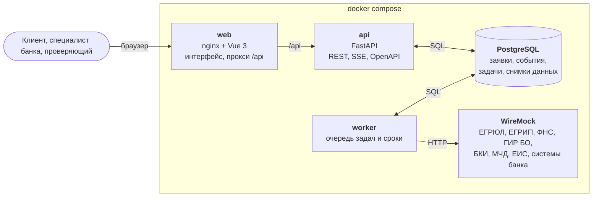
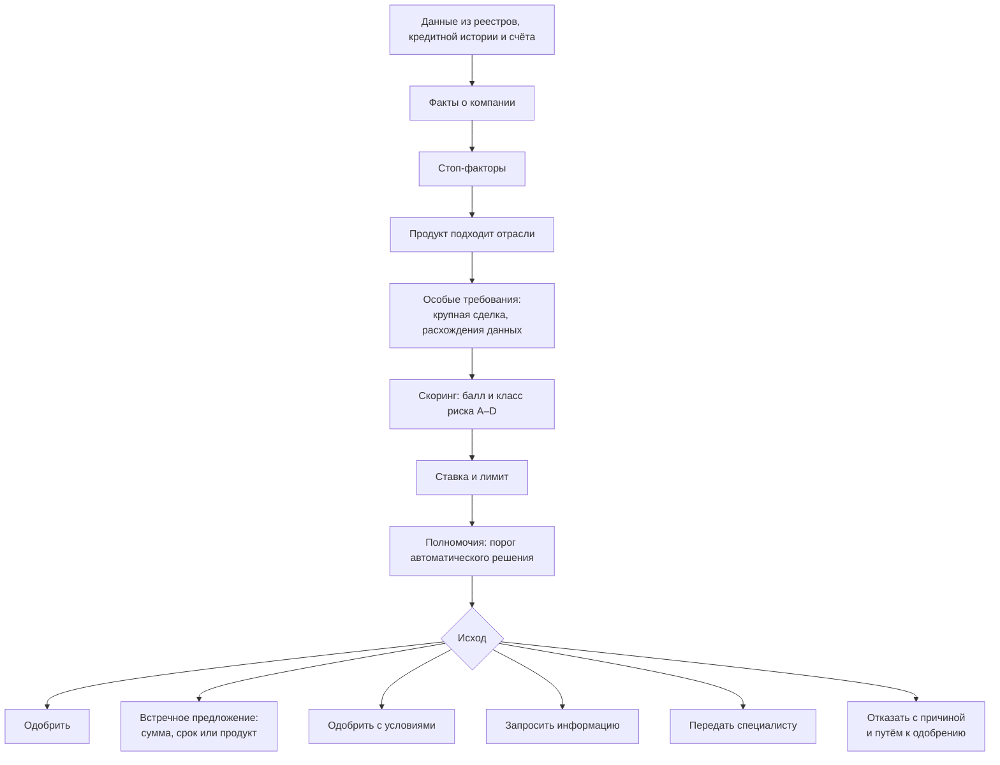
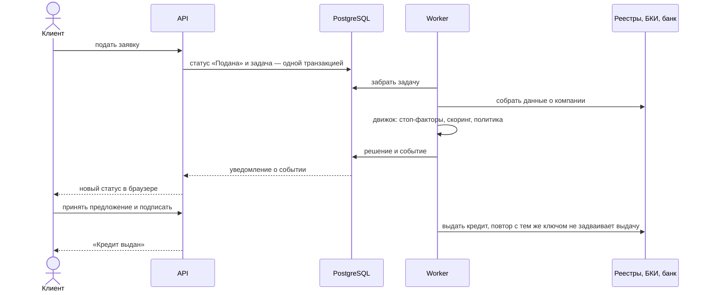

# Alfa Horizon

[](https://github.com/FigureZig/Alfa-Horizon/actions/workflows/backend.yml)

**Кредитный кабинет для малого бизнеса**, в котором путь клиента и работа банка над заявкой — один процесс: от момента, когда предпринимателю понадобились деньги, до их выдачи. Проект трека ММБ на Альфа Хак 2026. В интерфейсе продукт называется Fino Бизнес.

Обычно предприниматель заполняет длинную анкету и несколько дней ждёт ответа. Здесь наоборот: человек говорит, зачем ему деньги, банк сам собирает данные о компании из реестров, за секунды принимает решение и объясняет его простыми словами. Если скоро не хватит денег на счёте, кабинет заметит это заранее и предложит, как закрыть разрыв.

Все компании и люди вымышленные. Реестры ФНС, бухгалтерская отчётность, кредитная история и системы банка заменены моками в форматах настоящих источников.

[Запуск](#запуск) · [Первые пять минут](#первые-пять-минут) · [Что умеет](#что-умеет) · [Архитектура](#архитектура) · [Требования к окружению](#требования-к-окружению) · [Переменные окружения](#переменные-окружения) · [Сценарии](#готовые-сценарии) · [Документация](#документация) · [Разработка](#разработка)

---

## Запуск

Нужен Docker с Compose 2.20 или новее, больше ничего ставить не надо.

```bash
git clone https://github.com/FigureZig/Alfa-Horizon.git
cd Alfa-Horizon/infra
docker compose up --build
```

Первая сборка занимает несколько минут. Когда логи успокоятся, откройте стенд: локально это http://localhost:8080, на сервере — его адрес. Всё доступно через один порт:

| Путь | Что там |
|---|---|
| `/` | кабинет, начинать отсюда |
| `/api/docs` | описание API в Swagger, отсюда же можно отправлять запросы |
| `/api/redoc` | то же описание в ReDoc, его удобнее читать |
| `/api/openapi.json` | контракт API |

Служебные порты открыты только на самой машине: API напрямую — `127.0.0.1:8000`, моки внешних систем WireMock — `127.0.0.1:8081/__admin`, PostgreSQL — `127.0.0.1:55432` (логин и пароль `app`, база `credit`).

Запустить в фоне: `docker compose up --build -d`. Остановить: `docker compose down`. Стереть базу и начать с нуля: `docker compose down -v`.

### Если что-то пошло не так

- **Порт занят.** Поменяйте его переменной: `WEB_PORT=3000 docker compose up --build`. Остальные порты — в разделе [Переменные окружения](#переменные-окружения).
- **После `git pull` всё по-старому.** Пересоберите образы (`docker compose up --build`) и обновите страницу без кэша: Ctrl+Shift+R или Cmd+Shift+R.
- **Сразу после входа видны заглушки.** Банк в этот момент собирает данные о компании из реестров, через пару секунд всё появится.
- **Данные замусорились после прошлых прогонов.** «Как проверить» → «Мир» → «Сбросить мир». Совсем с нуля — `docker compose down -v` и запуск заново.

---

## Первые пять минут

1. Откройте стенд и нажмите «Войти». Пароль не нужен: считаем, что клиент уже вошёл в интернет-банк. Дальше два пути:
   - **«Пройти готовый сценарий»** — приложение проведёт по шагам: подскажет, кем войти, что нажать и какой статус должен получиться. Так быстрее всего увидеть продукт целиком, на сценарий уходит 2–3 минуты.
   - **Войти самому** — выберите компанию и человека, откроется его кабинет.

   При первом входе появится короткая подсказка. Открыть её снова можно ссылкой «Как пройти сценарий» на экране входа.
2. Чтобы посмотреть ту же заявку глазами другого человека, например директора после бухгалтера или специалиста банка, нажмите «Сменить» в шапке и войдите другим пользователем. Заявки при этом остаются на месте.
3. Справа внизу есть кнопка «Как проверить». Там все сценарии, управление миром (время, события в реестрах, сбои источников) и пояснения, где смотреть каждое решение продукта.

Проще всего начать с **Анны Смирновой** (ИП, кофейня): у неё прогноз денег на счёте, подбор кредита и заявки в разных статусах. За сторону банка — **Мария Соколова**, кредитный специалист.

---

## Что умеет

### Для клиента

- **Прогноз денег на 30 дней.** На главной видно, сколько денег на счёте сейчас и что будет дальше: какие платежи спишутся, что поступит и в какой день может не хватить. Если намечается кассовый разрыв, кабинет покажет дату, сумму и цену его закрытия.
- **Подбор кредита от задачи.** В продуктах банка разбираться не нужно. Человек выбирает, на что нужны деньги — закрыть кассовый разрыв, закупить товар, купить оборудование, — и видит, что банк готов дать именно ему: сумму, личную ставку и платёж. Если продукт не подходит, написано почему.
- **Заявка без анкеты.** Данные о компании банк берёт сам. Решение приходит через пару секунд, и рядом всегда есть блок «Почему такое решение»: из чего сложилась ставка, какие факторы повлияли, а при отказе — что сделать, чтобы одобрили.
- **Весь путь заявки в одном месте.** Предложение банка, подпись, выдача денег, ответы на запросы банка и история действий с именами собраны в карточке заявки. Список заявок разбит на «Нужно ваше действие», «В работе у банка» и «Завершённые».
- **Разные роли внутри компании.** Бухгалтер готовит заявку, а подписывает директор. Представитель по машиночитаемой доверенности (МЧД) подписывает сам, пока доверенность действует. Если сделка крупная, участники ООО голосуют по своим долям. Права каждого банк вычисляет из реестров, а не задаёт вручную.
- **Своя компания.** Можно ответить на несколько вопросов о своём бизнесе и посмотреть, что банк предложит такой компании. Каждый человек из неё сможет войти отдельно.

### Для банка

- **Очередь исключений.** Специалисту попадают только заявки, которые система не решила сама: например, данные реестров расходятся или сумма выше порога. Для каждой написано, почему нужен человек и сколько осталось времени.
- **Досье заявки.** Факты о компании с источниками, подсказка системы и решение специалиста: одобрить, отказать или запросить документы.
- **Второй ключ.** Если специалист одобряет сумму выше своих полномочий (больше 15 млн ₽), решение уходит на подтверждение риск-менеджеру.
- **Все заявки и метрики.** Полный реестр заявок, включая решённые автоматически, и статистика работы конвейера.

### Для проверяющих

- **Готовые сценарии** со сменой ролей: по шагам, с кнопками «Войти как …».
- **Часы мира.** Время можно перемотать вперёд, чтобы истекли сроки предложения или подписи. Мир стенда начинается 21 октября 2026 года.
- **События в реестрах.** Например, в ЕГРЮЛ сменился директор или погашена налоговая недоимка. Банк сам пересмотрит незавершённые заявки.
- **Сбои источников.** Можно «уронить» кредитное бюро или реестр и посмотреть, как система себя ведёт.

Всё это меняется на лету, без перезапуска.

---

## Архитектура

Модульный монолит на FastAPI, фоновый worker и PostgreSQL. Внешние системы заменены моками WireMock в форматах настоящих источников. Весь стенд — пять контейнеров, в простое они занимают около 275 МБ памяти.

### Из чего состоит стенд



- **API наружу не ходит.** Он читает сохранённые снимки данных и ставит задачи в очередь в одной транзакции со сменой статуса. Во внешние системы ходит только worker, поэтому сбой реестра не роняет кабинет: клиент видит данные с датой обновления, а заявка ждёт в очереди.
- **Очередь — в PostgreSQL.** Worker забирает задачи через `FOR UPDATE SKIP LOCKED`, отдельный брокер сообщений не нужен.
- **Статусы обновляются сами.** После записи события база шлёт уведомление (`LISTEN`/`NOTIFY`), и API передаёт его в браузер потоком SSE, без опроса.

### Как банк принимает решение



Скоринг и кредитное решение разделены. Скоринг оценивает риск компании: балльная карта даёт балл, вероятность дефолта и класс от A до D. Решение принимает политика конкретного продукта, поэтому один и тот же класс даёт разные лимиты и ставки по разным продуктам. Ставка складывается из ключевой ставки ЦБ, отраслевой надбавки и надбавки за риск, и клиент видит эту разбивку. Политика хранится в YAML с номером версии, а движок — чистая функция: те же факты и та же политика всегда дают тот же результат.

### Путь заявки



Все статусы и переходы — на [диаграмме состояний](docs/diagrams/application_state.md). Она строится из кода, поэтому не расходится с ним.

### Модули бэкенда

| Модуль | Что делает |
|---|---|
| [`app/domain/engine.py`](backend/app/domain/engine.py) | решение по заявке: стоп-факторы, требования, ставка и лимит, исход |
| [`app/domain/scoring.py`](backend/app/domain/scoring.py) | балльная карта: балл, вероятность дефолта, класс риска, вклад факторов |
| [`app/domain/matching.py`](backend/app/domain/matching.py) | подбор продукта от задачи клиента |
| [`app/domain/forecast.py`](backend/app/domain/forecast.py) | прогноз остатка на 30 дней и кассовый разрыв |
| [`app/domain/levers.py`](backend/app/domain/levers.py) | путь к одобрению: что изменить, чтобы банк дал больше |
| [`app/domain/rights.py`](backend/app/domain/rights.py) | права человека в компании: подготовить, подписать, проголосовать |
| [`app/domain/state.py`](backend/app/domain/state.py) | статусы заявки и допустимые переходы |
| [`app/lifecycle.py`](backend/app/lifecycle.py) | команды над заявкой: подать, принять, подписать, выдать |
| [`app/sources.py`](backend/app/sources.py), [`app/features.py`](backend/app/features.py) | запросы к внешним системам и разбор их форматов |
| [`policy/`](backend/policy) | кредитная политика: продукты, пороги, ставки, тексты причин |
| [`seed/`](backend/seed) | вымышленный мир симулятора и генератор моков |
| [`qa/`](backend/qa) | проверки и отчёты: граф статусов, pairwise-наборы, сценарии |

### Надёжность и сопровождение

- **Сбои источников.** У каждого источника свой предохранитель, ретраи и правило на случай, если данных нет: подождать, взять устаревшие, решить строже или передать человеку. Подробно — [`docs/07_resilience.md`](docs/07_resilience.md).
- **Выдача ровно один раз.** Повтор с тем же ключом идемпотентности не выдаёт деньги второй раз.
- **Аудит.** События связаны цепочкой хэшей, `GET /api/v1/bank/audit` проверяет её целостность.
- **Метрики.** `GET /api/v1/bank/metrics` считает долю решений без участия человека и время решения против SLA.
- **Тесты.** Юнит-тесты держат инварианты на pairwise-наборах компаний, e2e проходят все маршруты графа статусов и сверяют ответы с контрактом OpenAPI. CI запускает их при каждом изменении бэкенда и стенда, а на поднятом стенде прогоняет коллекцию запросов через newman.

---

## Требования к окружению

| Что | Нужно |
|---|---|
| Docker | Docker Engine или Docker Desktop с Compose 2.20 и новее (стенд использует `include`) |
| Память | около 300 МБ в простое |
| Диск | около 1,5 ГБ под образы |
| Процессор | проверено на x86-64, видеокарта не нужна |
| Сеть | интернет нужен для сборки образов и для ReDoc, который загружает скрипт с CDN |
| Порты | 8080 снаружи; 8000, 8081 и 55432 — только на `127.0.0.1` |

---

## Переменные окружения

Для запуска ничего задавать не нужно: у всех переменных есть значения по умолчанию. Поменять можно в окружении (`WEB_PORT=80 docker compose up -d`) или в файле `infra/.env`. Шаблон с описанием переменных бэкенда — [`backend/.env.example`](backend/.env.example).

**Стенд**

| Переменная | По умолчанию | Зачем |
|---|---|---|
| `WEB_PORT` | `8080` | порт кабинета, единственный, который нужен снаружи |
| `BIND_HOST` | `127.0.0.1` | адрес служебных портов; `0.0.0.0` откроет их наружу |
| `API_PORT` | `8000` | API напрямую |
| `WIREMOCK_PORT` | `8081` | моки внешних систем |
| `DB_PORT` | `55432` | PostgreSQL |
| `VITE_API_BASE_URL` | `/api` | адрес API, который фронтенд получает при сборке |
| `POSTGRES_USER`, `POSTGRES_PASSWORD`, `POSTGRES_DB` | `app`, `app`, `credit` | учётная запись и имя базы |

**Симулятор и функции**

| Переменная | По умолчанию | Зачем |
|---|---|---|
| `DEMO_MODE` | `true` | ручки симулятора: вход пользователем, своя компания, события, сбои, часы; при `false` их нет |
| `DEMO_TODAY` | `2026-10-21` | дата, с которой начинается мир симулятора; на неё построены моки |
| `DEMO_TOKEN_SECRET` | `dev-only-not-a-secret` | секрет подписи токенов; на публичном стенде задайте свой |
| `DEFAULT_PERSONA` | `s7` | от чьего имени отвечать на запрос без токена, пока никто не вошёл |
| `FEATURE_K1` … `FEATURE_K5` | `true` | прогноз остатка, предложение под разрыв, путь к одобрению, график из поступлений, кредит под госконтракт |
| `CORS_ORIGINS` | адреса dev-сервера фронтенда | откуда браузер может ходить в API напрямую; стенду не нужно, он ходит через `/api` |
| `LLM_ENABLED` | `false` | языковая модель выключена, основной сценарий работает без неё |

---

## Готовые сценарии

Каждый сценарий лучше начинать с чистого мира. Кнопка «Пройти заново» в сценарии сама снимет события, сбои и перемотку времени и удалит компании из конструктора.

| Сценарий | Компания | Кто входит по очереди | Что должно получиться |
|---|---|---|---|
| Крупная сделка: участники «за» | ООО «Мастер-Строй» | Елена Кравец → Алексей Ли | участники согласовали сделку, кредит выдан |
| Крупная сделка: участники «против» | ООО «Мастер-Строй» | Елена Кравец → Алексей Ли → Константин Морозов | без согласия участников банк закрывает заявку |
| Бухгалтер готовит, директор подписывает | ООО «Лента-Опт» | Иван Иванов → Олег Захаров | бухгалтеру подписать нельзя, подписывает директор |
| Второй ключ | ООО «Склад-Логистик» | Иван Иванов → Андрей Фомин → Мария Соколова → Олег Ветров → Сергей Никитин | специалист одобряет 18 млн ₽, риск-менеджер подтверждает, кредит выдан |
| Специалист запрашивает документы | ООО «Северный Хлеб» | Иван Иванов → Мария Соколова | банк просит пояснения, клиент отвечает, заявку одобряют |
| Смена директора во время подписи | ООО «Лента-Опт» | Олег Захаров → Наталья Новикова | подпись останавливается, прежний директор больше не может подписать |
| Подпись по доверенности | ООО «Вектор-Трейд» | Ольга Кузнецова → Павел Орлов | представитель подписывает по МЧД; после отзыва доверенности — только директор |
| Подписывает представитель по МЧД | ООО «Вектор-Трейд» | Ольга Кузнецова | представитель сам доводит заявку до подписи |
| Отказ и путь к одобрению | ООО «Ромашка-Сервис» | Игорь Белов | сначала отказ с понятной причиной, после исправления — одобрение |

Подробно по шагам — в самом приложении («Пройти готовый сценарий») и в [`docs/15_roles.md`](docs/15_roles.md).

### Кем можно войти

| Кто | Роль | Компания и чем интересен |
|---|---|---|
| Анна Смирнова | ИП | кофейня; прогноз, подбор кредита, заявки в разных статусах |
| Павел Орлов | директор | ООО «Вектор-Трейд», оптовая торговля; подпись по доверенности |
| Елена Кравец | директор | ООО «Мастер-Строй», три участника; крупная сделка с голосованием |
| Игорь Белов | директор | ООО «Ромашка-Сервис», клининг; отказ и путь к одобрению |
| Иван Иванов | директор | ООО «Северный Хлеб»; ещё участник «Склад-Логистик» и бухгалтер «Лента-Опт», видно несколько компаний сразу |
| Артём Гусев | директор | ООО «Код и Облако», разработка; оплаты по договорам |
| Мария Полякова | директор | агрохозяйство; сезонный кредит, деньги приходят после урожая |
| Олег Захаров | директор | ООО «Лента-Опт», оптовая торговля продуктами |
| Мария Соколова | специалист банка | очередь заявок, решения до 15 млн ₽ |
| Олег Ветров | риск-менеджер | второй ключ для сумм выше 15 млн ₽ |

Остальные люди — участники ООО, сотрудники, представители — появляются в сценариях. Их можно выбрать в карточке компании на экране входа.

---

## Документация

Входная точка — [`docs/README.md`](docs/README.md): с чего начать и карта всех документов. Артефакты, которые просит кейс:

| Артефакт | Где |
|---|---|
| Архитектурная схема | раздел [Архитектура](#архитектура) выше, подробно — [`docs/06_architecture.md`](docs/06_architecture.md) и схемы C4 в [`docs/diagrams/`](docs/diagrams) |
| Описание API и OpenAPI | на стенде `/api/redoc` и `/api/docs`; контракт [`docs/api/openapi.json`](docs/api/openapi.json), соглашения [`docs/api/README.md`](docs/api/README.md) |
| Коллекция запросов | [`docs/api/postman_collection.json`](docs/api/postman_collection.json): вход, кабинет, заявка до выдачи и все сценарии ролей; CI прогоняет её через newman |
| Диаграмма состояний заявки | [`docs/diagrams/application_state.md`](docs/diagrams/application_state.md) |
| Модель данных | [`docs/diagrams/data_model.md`](docs/diagrams/data_model.md) |
| Тестовые сценарии | [`docs/test-scenarios.md`](docs/test-scenarios.md), роли и права — [`docs/15_roles.md`](docs/15_roles.md) |
| Синтетические данные и учётные записи | раздел [Кем можно войти](#кем-можно-войти), мир симулятора — [`backend/seed/personas.yaml`](backend/seed/personas.yaml) |
| Сторонние компоненты и смоделированные интеграции | [`THIRD_PARTY_NOTICES.md`](THIRD_PARTY_NOTICES.md) |

---

## Разработка

Обычно это не нужно: `docker compose up` в `infra/` поднимает всё сразу. Но если правите код и не хотите каждый раз пересобирать образы, запускайте по частям.

**Бэкенд** (Python 3.13+ и [uv](https://docs.astral.sh/uv/)):

```bash
cd backend
cp .env.example .env
docker compose up -d postgres wiremock        # база и моки в Docker
uv sync
uv run --env-file .env python -m app.migrate
uv run --env-file .env uvicorn app.main:app --reload --port 8000
uv run --env-file .env python -m app.worker   # в отдельном терминале
```

**Фронтенд** (Node.js 20.11.1 и pnpm 10):

```bash
cd frontend
pnpm install
cp .env.example .env
pnpm dev                                      # dev-сервер на порту 5173, API — через прокси на порт 8000
```

**Проверки:**

```bash
cd backend && uv run ruff check . && uv run pytest     # бэкенд: линтер и тесты
cd backend && uv run pytest -m e2e                     # сквозные тесты, нужны Postgres и WireMock
cd frontend && pnpm lint && pnpm build                 # фронтенд: линтер и сборка
```

Как устроена работа с репозиторием, что проверить перед PR и какие документы пересобрать — в [`CONTRIBUTING.md`](CONTRIBUTING.md).

### Структура репозитория

| Папка | Что внутри |
|---|---|
| [`frontend/`](frontend/README.md) | кабинет клиента и рабочее место банка: Vue 3, PrimeVue, Tailwind |
| [`backend/`](backend/README.md) | API и worker на FastAPI: решение по заявке, скоринг, права, статусы, моки внешних систем, тесты |
| [`infra/`](infra/docker-compose.yml) | один `docker-compose.yml` на весь стенд |
| [`docs/`](docs/README.md) | документация: продукт, движок решений, скоринг, архитектура, контракт API, диаграммы |
