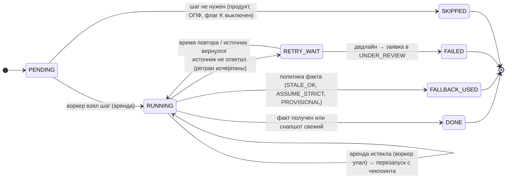
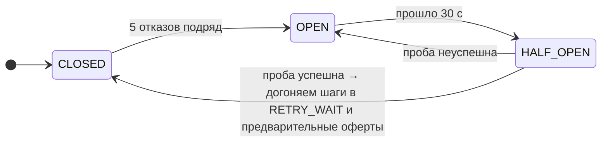

# State machine заявки, шагов конвейера и breaker

Ground truth по состояниям (синхронно с `02_product.md` §6, `04_decision_engine.md` §8, `07_resilience.md`). В репозитории диаграмму заявки генерируем
из таблицы переходов в коде, чтобы не разъехалась. Процесс по шагам — `scenarios-bpmn.drawio`: K0, S0, E1, D1–D4, F1–F2.

## 1. Заявка

```mermaid
stateDiagram-v2
    direction LR
    [*] --> DRAFT: подбор (U2) / оффер K2 «Закрыть разрыв» / клон после K3
    DRAFT --> SUBMITTED: подать (sign)
    DRAFT --> WITHDRAWN: удалить / 30 дн.

    SUBMITTED --> CHECKING: старт конвейера
    SUBMITTED --> WITHDRAWN: отозвать
    CHECKING --> OFFERED: APPROVE · COUNTER_OFFER · APPROVE_WITH_CONDITIONS
    CHECKING --> INFO_REQUESTED: REQUEST_INFO
    CHECKING --> UNDER_REVIEW: MANUAL_REVIEW / источник недоступен до дедлайна
    CHECKING --> REJECTED: REJECT (стоп-фактор / политика)

    INFO_REQUESTED --> CHECKING: ответ (системный дозапрос)
    INFO_REQUESTED --> UNDER_REVIEW: ответ (дозапрос аналитика)
    INFO_REQUESTED --> EXPIRED: срок истёк

    UNDER_REVIEW --> OFFERED: одобрить как есть / с изменёнными условиями
    UNDER_REVIEW --> INFO_REQUESTED: дозапрос
    UNDER_REVIEW --> REJECTED: отказ

    OFFERED --> SIGNING: принять (sign), выбрать вариант и график (K4)
    OFFERED --> DECLINED: отказаться / «хочу как просил» → клон в DRAFT (K3)
    OFFERED --> EXPIRED: срок оферты истёк
    OFFERED --> CHECKING: пересмотр — новые данные (RECHECK)

    SIGNING --> SIGNED: все подписанты подписали (ПЭП)
    SIGNING --> EXPIRED: срок истёк
    SIGNING --> CHECKING: пересмотр — новые данные (RECHECK)
    SIGNED --> DISBURSING: перепроверка по свежим данным пройдена
    SIGNED --> REJECTED: всплыл стоп-фактор (ГК 821 п. 1)
    DISBURSING --> ISSUED: зачислено (сверка по ключу)
    DISBURSING --> UNDER_REVIEW: сбой АБС до дедлайна (DISBURSE_ERROR)

    CHECKING --> WITHDRAWN: отозвать
    INFO_REQUESTED --> WITHDRAWN: отозвать
    UNDER_REVIEW --> WITHDRAWN: отозвать
    OFFERED --> WITHDRAWN: отозвать
    SIGNING --> WITHDRAWN: отозвать
    SIGNED --> WITHDRAWN: отказ от получения (ГК 821 п. 2)

    ISSUED --> [*]: → кредит (график; K4 — % от поступлений), K1 следит дальше
    REJECTED --> [*]: → причины, путь к одобрению (K3), альтернативы
    DECLINED --> [*]: → подбор
    WITHDRAWN --> [*]: → новая заявка
    EXPIRED --> [*]: → подать снова (клон)

    note right of OFFERED
        Вид оферты — поле offerKind, не статус:
        AS_REQUESTED · COUNTER (сумма | срок | продукт) · CONDITIONAL (поручительство | залог)
        Флаг PROVISIONAL — подпись после проверки КИ
    end note
```

Терминальные: ISSUED, REJECTED, DECLINED, WITHDRAWN, EXPIRED; у каждого есть кнопка «что дальше».
**Флаги** (бейджи, не статусы): `DEGRADED_DATA`, `SOURCE_WAIT`, `PROVISIONAL`, `RECHECK`, `SLA_BREACH`, `DISBURSE_ERROR` (02 §6).
**decision.outcome → статус:** APPROVE, COUNTER_OFFER, APPROVE_WITH_CONDITIONS → OFFERED; REQUEST_INFO → INFO_REQUESTED; MANUAL_REVIEW → UNDER_REVIEW; REJECT → REJECTED.
Слой K статусов не добавляет: K2 и K3 создают обычный DRAFT, K4 — параметр оферты и кредита.

## 2. Шаг конвейера (`jobs.status`)

## 3. Breaker источника (`kv`, ключ `breaker:<источник>`)

Пока breaker в OPEN, вызова нет: шаг сразу идёт по политике факта, без ожидания таймаутов. Параметры — конфиг (07 §3).
