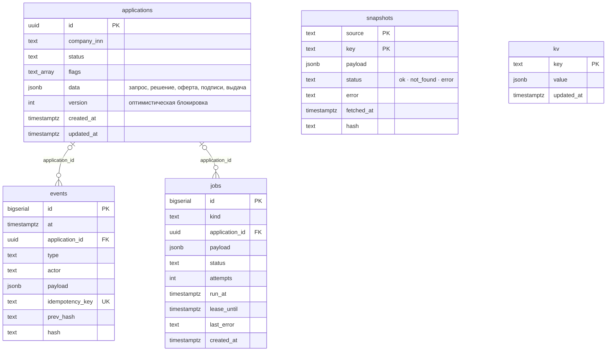
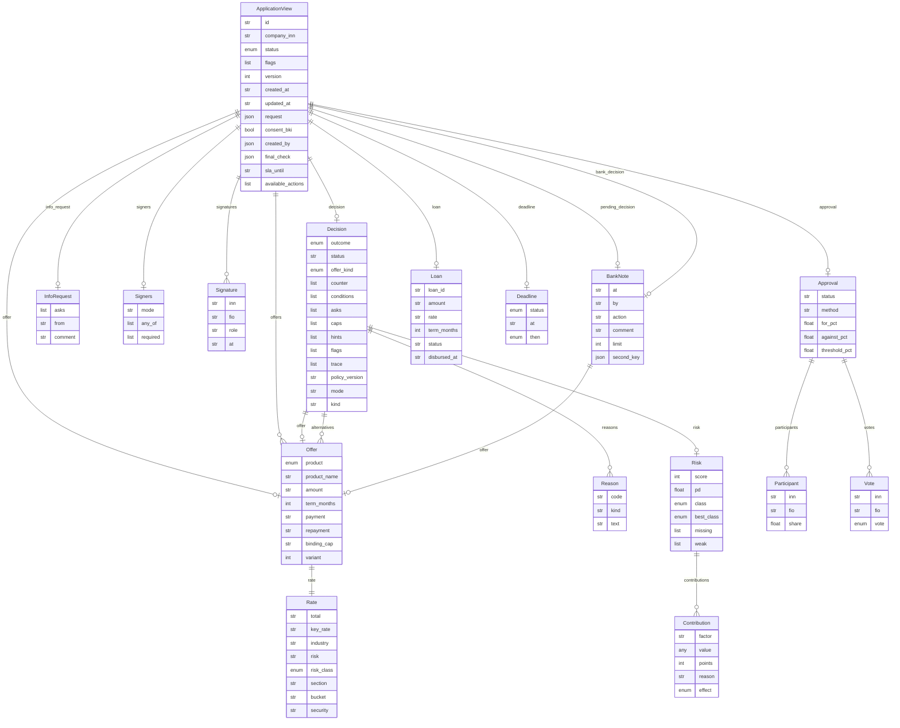

# Модель данных

Сгенерировано из кода: `cd backend && uv run python -m qa.er`. Физическая модель — из `backend/migrations/*.sql`, логическая — из схем ответов API `backend/app/api/schemas.py`. Почему так мало таблиц — `06_architecture.md` §4.

## 1. Таблицы PostgreSQL

- `applications` — заявка целиком
- `events` — история и аудит, только добавление
- `jobs` — очередь задач worker и таймеры
- `snapshots` — ответы реестров и банка с происхождением
- `kv` — операционные мелочи

Компания и человек — не таблицы: их данные приходят из реестров и банка и лежат в `snapshots` (ключ — ИНН), права считаются на лету. Продукты, правила и скоринг — `policy/*.yaml`, версия политики пишется в каждое решение.

## 2. Заявка как документ (`applications.data`)

Запрос, решение движка с причинами и скорингом, оферта и варианты, подписи, согласие участников, решения банка и выдача хранятся одним документом заявки: читаются вместе, меняются в одной транзакции с событием в `events`. Те же поля отдаёт `GET /api/v1/applications/{id}` (схема `ApplicationView` в Swagger и ReDoc).

