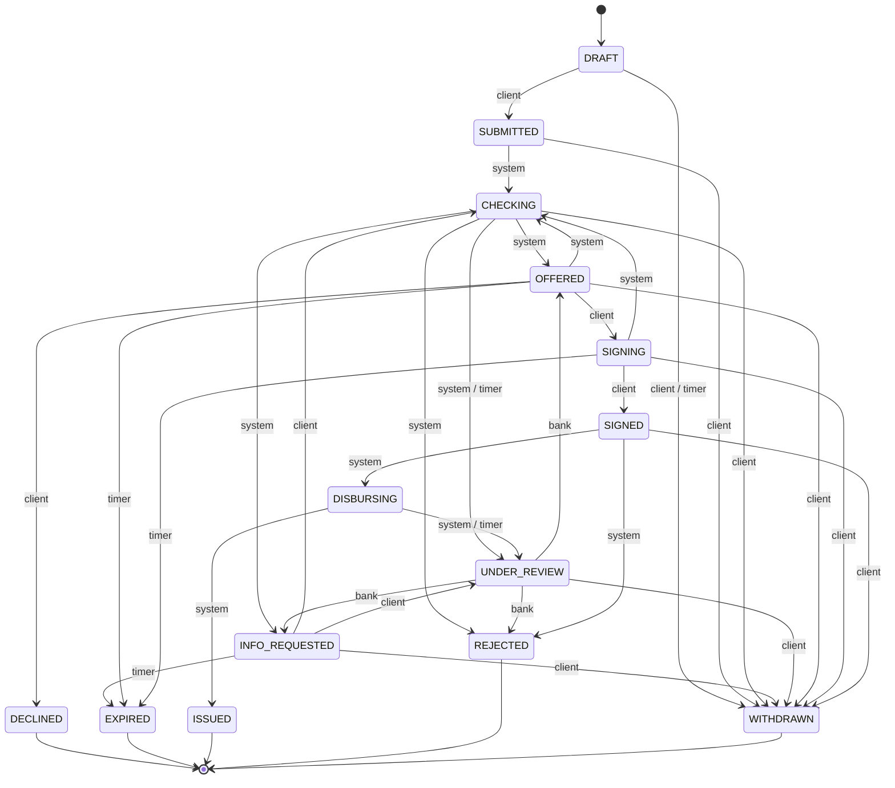

# Тестовые сценарии ядра

Сгенерировано из кода: `cd backend && uv run python -m qa.report`. Руками не править — источник правды: `app/domain/state.py`, `policy/`, `seed/world.py`, `qa/`. Конкретные числа демо-мира держат golden-сценарии (`tests/test_scenarios.py`, `seed/personas.yaml`). Политика 2026.10-1+a7c55e27, дата мира 2026-10-21.

## 1. Жизненный цикл заявки как граф

Статусов 14, переходов 31; инициаторы переходов: специалист — 3, клиент — 14, конвейер — 11, таймер — 6. Таблица — `app/domain/state.py`.

| Проверка | Результат |
|---|---|
| недостижимые из DRAFT статусы | нет |
| тупики: нетерминальный статус без пути к терминалу (deadlock) | нет |
| замкнутые круги без выхода (livelock, сильно связные компоненты) | нет |
| терминалы с исходящими переходами | нет |
| статусы без выхода по таймеру или конвейеру | UNDER_REVIEW — ждёт специалиста, срок держит SLA |



## 2. Минимальный набор сквозных прогонов

16 прогонов проходят все 31 переходов, всего 80 шагов. Меньше нельзя: каждый прогон кончается одним из 16 переходов в терминал. Поиск — задача китайского почтальона: циркуляция минимальной стоимости с нижней границей 1 на переходе, затем разложение на кратчайшие пути и циклы, каждый цикл встроен в самый короткий подходящий прогон (`qa/graph.py`).

| # | Итог | Маршрут (кто запускает шаг) | Шагов |
|---|---|---|---|
| 1 | ISSUED | DRAFT → _клиент_ → SUBMITTED → _конвейер_ → CHECKING → _конвейер_ → OFFERED → _клиент_ → SIGNING → _клиент_ → SIGNED → _конвейер_ → DISBURSING → _конвейер_ → ISSUED | 7 |
| 2 | REJECTED | DRAFT → _клиент_ → SUBMITTED → _конвейер_ → CHECKING → _конвейер/таймер_ → UNDER_REVIEW → _специалист_ → REJECTED | 4 |
| 3 | REJECTED | DRAFT → _клиент_ → SUBMITTED → _конвейер_ → CHECKING → _конвейер_ → OFFERED → _клиент_ → SIGNING → _клиент_ → SIGNED → _конвейер_ → REJECTED | 6 |
| 4 | REJECTED | DRAFT → _клиент_ → SUBMITTED → _конвейер_ → CHECKING → _конвейер_ → OFFERED → _клиент_ → SIGNING → _клиент_ → SIGNED → _конвейер_ → DISBURSING → _конвейер/таймер_ → UNDER_REVIEW → _специалист_ → OFFERED → _клиент_ → SIGNING → _конвейер_ → CHECKING → _конвейер_ → REJECTED | 11 |
| 5 | DECLINED | DRAFT → _клиент_ → SUBMITTED → _конвейер_ → CHECKING → _конвейер_ → INFO_REQUESTED → _клиент_ → CHECKING → _конвейер_ → OFFERED → _клиент_ → DECLINED | 6 |
| 6 | WITHDRAWN | DRAFT → _клиент/таймер_ → WITHDRAWN | 1 |
| 7 | WITHDRAWN | DRAFT → _клиент_ → SUBMITTED → _клиент_ → WITHDRAWN | 2 |
| 8 | WITHDRAWN | DRAFT → _клиент_ → SUBMITTED → _конвейер_ → CHECKING → _конвейер_ → OFFERED → _клиент_ → WITHDRAWN | 4 |
| 9 | WITHDRAWN | DRAFT → _клиент_ → SUBMITTED → _конвейер_ → CHECKING → _конвейер_ → INFO_REQUESTED → _клиент_ → WITHDRAWN | 4 |
| 10 | WITHDRAWN | DRAFT → _клиент_ → SUBMITTED → _конвейер_ → CHECKING → _конвейер/таймер_ → UNDER_REVIEW → _клиент_ → WITHDRAWN | 4 |
| 11 | WITHDRAWN | DRAFT → _клиент_ → SUBMITTED → _конвейер_ → CHECKING → _конвейер_ → OFFERED → _конвейер_ → CHECKING → _клиент_ → WITHDRAWN | 5 |
| 12 | WITHDRAWN | DRAFT → _клиент_ → SUBMITTED → _конвейер_ → CHECKING → _конвейер_ → OFFERED → _клиент_ → SIGNING → _клиент_ → WITHDRAWN | 5 |
| 13 | WITHDRAWN | DRAFT → _клиент_ → SUBMITTED → _конвейер_ → CHECKING → _конвейер_ → OFFERED → _клиент_ → SIGNING → _клиент_ → SIGNED → _клиент_ → WITHDRAWN | 6 |
| 14 | EXPIRED | DRAFT → _клиент_ → SUBMITTED → _конвейер_ → CHECKING → _конвейер_ → OFFERED → _таймер_ → EXPIRED | 4 |
| 15 | EXPIRED | DRAFT → _клиент_ → SUBMITTED → _конвейер_ → CHECKING → _конвейер_ → OFFERED → _клиент_ → SIGNING → _таймер_ → EXPIRED | 5 |
| 16 | EXPIRED | DRAFT → _клиент_ → SUBMITTED → _конвейер_ → CHECKING → _конвейер_ → INFO_REQUESTED → _клиент_ → UNDER_REVIEW → _специалист_ → INFO_REQUESTED → _таймер_ → EXPIRED | 6 |

Как вызвать каждый переход в демо:

| Переход | Кто | Как |
|---|---|---|
| DRAFT → SUBMITTED | клиент | клиент подаёт заявку |
| DRAFT → WITHDRAWN | клиент, таймер | клиент удаляет черновик или 30 дней без подачи |
| SUBMITTED → CHECKING | конвейер | worker берёт задачу конвейера |
| SUBMITTED → WITHDRAWN | клиент | клиент отзывает до старта конвейера (воркер на паузе) |
| CHECKING → OFFERED | конвейер | решение APPROVE / COUNTER_OFFER / APPROVE_WITH_CONDITIONS (пресеты S7, S3, S8) |
| CHECKING → INFO_REQUESTED | конвейер | решение REQUEST_INFO (пресет S2: крупная сделка без согласия участников) |
| CHECKING → UNDER_REVIEW | конвейер, таймер | решение MANUAL_REVIEW (S5: выше полномочий) или источник не ответил до дедлайна (N2) |
| CHECKING → REJECTED | конвейер | решение REJECT (S4: недоимка) |
| CHECKING → WITHDRAWN | клиент | клиент отзывает во время проверки (воркер на паузе) |
| INFO_REQUESTED → CHECKING | клиент | клиент отвечает на системный дозапрос — конвейер заново |
| INFO_REQUESTED → UNDER_REVIEW | клиент | клиент отвечает на дозапрос специалиста |
| INFO_REQUESTED → EXPIRED | таймер | срок ответа истёк (сдвиг часов песочницы) |
| INFO_REQUESTED → WITHDRAWN | клиент | клиент отзывает |
| UNDER_REVIEW → OFFERED | специалист | специалист одобряет на экране банка |
| UNDER_REVIEW → INFO_REQUESTED | специалист | специалист запрашивает документ |
| UNDER_REVIEW → REJECTED | специалист | специалист отказывает |
| UNDER_REVIEW → WITHDRAWN | клиент | клиент отзывает |
| OFFERED → SIGNING | клиент | клиент принимает оферту |
| OFFERED → DECLINED | клиент | клиент отказывается от оферты |
| OFFERED → EXPIRED | таймер | срок оферты истёк (сдвиг часов) |
| OFFERED → CHECKING | конвейер | событие мира: изменились данные реестра — пересмотр (RECHECK, N17) |
| OFFERED → WITHDRAWN | клиент | клиент отзывает |
| SIGNING → SIGNED | клиент | подписали все, кто должен (ЕИО или представитель по МЧД) |
| SIGNING → EXPIRED | таймер | срок подписи истёк (сдвиг часов) |
| SIGNING → CHECKING | конвейер | событие мира до подписи — пересмотр (RECHECK) |
| SIGNING → WITHDRAWN | клиент | клиент отзывает |
| SIGNED → DISBURSING | конвейер | перепроверка по свежим данным пройдена |
| SIGNED → REJECTED | конвейер | при перепроверке всплыл стоп-фактор (ГК ст. 821 п. 1) |
| SIGNED → WITHDRAWN | клиент | клиент отказывается от получения (ГК ст. 821 п. 2) |
| DISBURSING → ISSUED | конвейер | АБС подтвердила зачисление |
| DISBURSING → UNDER_REVIEW | конвейер, таймер | сбой АБС до дедлайна (отказ abs в песочнице, N7) |

## 3. Свои персоны: pairwise

Персона строится из осей тем же `seed/world.py`, что демо-мир: ИНН и ОГРН с контрольными цифрами, выписка, кредиты в БКИ, отчётность — согласованы между собой. Ответы источников проходят через JSON, как из WireMock. Набор векторов — IPOG (allpairspy): каждая пара значений любых двух осей встречается хотя бы раз.

Профили: strong — класс A, average — B, weak — C, risky — D (`qa/pairwise.py`). Суммы: below_min — половина минимума продукта, at_min — минимум, fits — посильная, large — около трети активов (крупная сделка), above_authority — 12 000 000 ₽.

### 3.1. healthy: все источники отвечают — проверяются числа оферт

Оси — form (4): IP, LLC_SOLE, LLC_MULTI, JSC; section (8): I, G, C, F, A, J, H, Q; product (6): OVERDRAFT, EXPRESS, WORKING_CAPITAL, INVESTMENT, CONTRACT, AGRO_SEASONAL; amount (5): below_min, at_min, fits, large, above_authority; profile (4): strong, average, weak, risky; term (3): min, mid, max. Векторов: 49; исходы: APPROVE 11, COUNTER_OFFER 16, MANUAL_REVIEW 8, REJECT 12, REQUEST_INFO 2.

| # | Форма | Раздел | Продукт | Сумма | Профиль | Срок | Исход | Класс | Оферта | Причины |
|---|---|---|---|---|---|---|---|---|---|---|
| 1 | IP | I | OVERDRAFT | below_min | strong | min | REJECT | — | — | POL_AMOUNT_RANGE |
| 2 | LLC_SOLE | G | EXPRESS | at_min | average | min | APPROVE | B | EXPRESS 300 000 ₽ · 3 мес. · 19,4% | — |
| 3 | LLC_MULTI | C | WORKING_CAPITAL | fits | weak | min | COUNTER_OFFER | C | OVERDRAFT 360 000 ₽ · 12 мес. · 19,7% | CAP_PAYMENT_CAPACITY, POL_AMOUNT_MIN, CAP_TURNOVER |
| 4 | JSC | F | INVESTMENT | large | risky | min | REJECT | D | — | POL_RISK_CLASS, SC_DECLINING_INFLOWS, SC_YOUNG_BUSINESS, SC_DELINQUENCY |
| 5 | JSC | A | CONTRACT | above_authority | weak | mid | REJECT | C | — | CAP_INTEREST_CAPACITY, POL_AMOUNT_MIN |
| 6 | LLC_MULTI | J | AGRO_SEASONAL | above_authority | average | max | COUNTER_OFFER | B | WORKING_CAPITAL 1 300 000 ₽ · 12 мес. · 17,7% | POL_PRODUCT_FIT, CAP_PAYMENT_CAPACITY |
| 7 | LLC_SOLE | H | AGRO_SEASONAL | below_min | risky | mid | MANUAL_REVIEW | D | — | POL_PRODUCT_FIT, POL_PRODUCT_REVIEW |
| 8 | IP | Q | CONTRACT | large | average | mid | APPROVE | B | CONTRACT 7 200 000 ₽ · 12 мес. · 19,8% | — |
| 9 | IP | H | INVESTMENT | fits | strong | max | MANUAL_REVIEW | A | INVESTMENT 12 000 000 ₽ · 84 мес. · 21,3% | POL_PRODUCT_REVIEW, POL_AUTHORITY_EXCEEDED |
| 10 | LLC_SOLE | J | WORKING_CAPITAL | large | strong | mid | MANUAL_REVIEW | A | WORKING_CAPITAL 19 200 000 ₽ · 24 мес. · 23,3% | POL_AUTHORITY_EXCEEDED |
| 11 | LLC_MULTI | A | OVERDRAFT | at_min | risky | max | MANUAL_REVIEW | D | — | POL_PRODUCT_REVIEW |
| 12 | JSC | Q | EXPRESS | fits | risky | max | REJECT | D | — | POL_RISK_CLASS, SC_DECLINING_INFLOWS, SC_YOUNG_BUSINESS, SC_DELINQUENCY |
| 13 | JSC | I | WORKING_CAPITAL | at_min | average | max | COUNTER_OFFER | B | EXPRESS 1 000 000 ₽ · 36 мес. · 19,6% | POL_PRODUCT_FIT |
| 14 | LLC_MULTI | G | CONTRACT | below_min | strong | max | REJECT | — | — | POL_AMOUNT_RANGE |
| 15 | LLC_SOLE | F | OVERDRAFT | above_authority | weak | max | COUNTER_OFFER | C | OVERDRAFT 360 000 ₽ · 12 мес. · 19,0% | CAP_TURNOVER |
| 16 | IP | C | AGRO_SEASONAL | at_min | strong | mid | COUNTER_OFFER | A | EXPRESS 500 000 ₽ · 10 мес. · 16,7% | POL_PRODUCT_FIT |
| 17 | IP | F | EXPRESS | above_authority | strong | mid | COUNTER_OFFER | A | EXPRESS 10 000 000 ₽ · 24 мес. · 16,0% | CAP_PRODUCT_MAX |
| 18 | LLC_MULTI | I | INVESTMENT | above_authority | risky | mid | REJECT | D | — | POL_RISK_CLASS, SC_DECLINING_INFLOWS, SC_YOUNG_BUSINESS, SC_DELINQUENCY |
| 19 | JSC | H | OVERDRAFT | large | average | max | COUNTER_OFFER | B | OVERDRAFT 1 200 000 ₽ · 12 мес. · 20,6% | CAP_TURNOVER |
| 20 | LLC_SOLE | C | CONTRACT | fits | average | max | APPROVE | B | CONTRACT 2 400 000 ₽ · 24 мес. · 19,4% | — |
| 21 | JSC | G | AGRO_SEASONAL | fits | weak | mid | COUNTER_OFFER | C | OVERDRAFT 360 000 ₽ · 12 мес. · 21,4% | POL_PRODUCT_FIT, CAP_TURNOVER |
| 22 | IP | J | INVESTMENT | below_min | weak | min | REJECT | — | — | POL_PRODUCT_FIT |
| 23 | LLC_MULTI | Q | WORKING_CAPITAL | above_authority | strong | min | MANUAL_REVIEW | A | WORKING_CAPITAL 12 000 000 ₽ · 9 мес. · 18,8% | CAP_PAYMENT_CAPACITY, POL_AUTHORITY_EXCEEDED |
| 24 | LLC_MULTI | H | EXPRESS | large | weak | min | COUNTER_OFFER | C | OVERDRAFT 360 000 ₽ · 12 мес. · 22,6% | CAP_PAYMENT_CAPACITY, POL_AMOUNT_MIN, CAP_TURNOVER |
| 25 | IP | A | WORKING_CAPITAL | below_min | average | min | COUNTER_OFFER | B | EXPRESS 500 000 ₽ · 9 мес. · 17,0% | POL_AMOUNT_RANGE, CAP_PAYMENT_CAPACITY |
| 26 | JSC | C | OVERDRAFT | below_min | strong | mid | REJECT | — | — | POL_AMOUNT_RANGE |
| 27 | LLC_SOLE | A | INVESTMENT | at_min | strong | mid | MANUAL_REVIEW | A | INVESTMENT 3 000 000 ₽ · 60 мес. · 16,3% | POL_PRODUCT_REVIEW |
| 28 | IP | G | INVESTMENT | above_authority | risky | mid | REJECT | D | — | POL_RISK_CLASS, SC_DECLINING_INFLOWS, SC_YOUNG_BUSINESS, SC_DELINQUENCY |
| 29 | LLC_SOLE | Q | AGRO_SEASONAL | at_min | weak | min | COUNTER_OFFER | C | OVERDRAFT 360 000 ₽ · 12 мес. · 21,8% | POL_PRODUCT_FIT, CAP_TURNOVER |
| 30 | LLC_SOLE | I | CONTRACT | at_min | weak | min | REJECT | — | — | POL_PRODUCT_FIT |
| 31 | JSC | J | CONTRACT | at_min | risky | mid | REJECT | D | — | POL_RISK_CLASS, SC_DECLINING_INFLOWS, SC_YOUNG_BUSINESS, SC_DELINQUENCY |
| 32 | LLC_MULTI | F | AGRO_SEASONAL | at_min | average | mid | COUNTER_OFFER | B | EXPRESS 500 000 ₽ · 10 мес. · 17,0% | POL_PRODUCT_FIT |
| 33 | LLC_MULTI | C | INVESTMENT | above_authority | average | mid | MANUAL_REVIEW | B | INVESTMENT 4 900 000 ₽ · 60 мес. · 18,9% | POL_PRODUCT_REVIEW, CAP_PAYMENT_CAPACITY |
| 34 | LLC_MULTI | F | WORKING_CAPITAL | below_min | risky | mid | MANUAL_REVIEW | D | — | POL_AMOUNT_RANGE, POL_PRODUCT_REVIEW |
| 35 | LLC_MULTI | I | AGRO_SEASONAL | large | average | mid | COUNTER_OFFER | B | EXPRESS 1 100 000 ₽ · 10 мес. · 17,0% | POL_PRODUCT_FIT, CAP_PAYMENT_CAPACITY |
| 36 | LLC_MULTI | A | EXPRESS | below_min | average | mid | COUNTER_OFFER | B | OVERDRAFT 150 000 ₽ · 12 мес. · 17,0% | POL_AMOUNT_RANGE |
| 37 | LLC_MULTI | H | WORKING_CAPITAL | at_min | average | mid | APPROVE | B | WORKING_CAPITAL 1 000 000 ₽ · 24 мес. · 22,3% | — |
| 38 | LLC_MULTI | A | AGRO_SEASONAL | large | average | mid | REQUEST_INFO | B | AGRO_SEASONAL 7 200 000 ₽ · 10 мес. · 17,0% | REQ_CORP_APPROVAL |
| 39 | LLC_MULTI | C | EXPRESS | large | risky | mid | REJECT | D | — | POL_RISK_CLASS, SC_DECLINING_INFLOWS, SC_YOUNG_BUSINESS, SC_DELINQUENCY |
| 40 | LLC_MULTI | J | OVERDRAFT | fits | average | mid | APPROVE | B | OVERDRAFT 750 000 ₽ · 12 мес. · 17,7% | — |
| 41 | LLC_MULTI | Q | INVESTMENT | below_min | average | mid | COUNTER_OFFER | B | EXPRESS 1 500 000 ₽ · 36 мес. · 21,4% | POL_AMOUNT_RANGE |
| 42 | LLC_MULTI | G | WORKING_CAPITAL | large | average | mid | COUNTER_OFFER | B | WORKING_CAPITAL 2 400 000 ₽ · 24 мес. · 22,7% | CAP_PAYMENT_CAPACITY |
| 43 | LLC_MULTI | H | CONTRACT | above_authority | average | mid | REQUEST_INFO | B | CONTRACT 8 600 000 ₽ · 12 мес. · 20,6% | CAP_INTEREST_CAPACITY, REQ_CORP_APPROVAL |
| 44 | LLC_MULTI | I | EXPRESS | fits | average | mid | APPROVE | B | EXPRESS 1 800 000 ₽ · 24 мес. · 19,6% | — |
| 45 | LLC_MULTI | F | CONTRACT | fits | average | mid | APPROVE | B | CONTRACT 2 400 000 ₽ · 12 мес. · 17,0% | — |
| 46 | LLC_MULTI | A | CONTRACT | fits | average | mid | APPROVE | B | CONTRACT 2 400 000 ₽ · 12 мес. · 17,0% | — |
| 47 | LLC_MULTI | G | OVERDRAFT | at_min | average | mid | APPROVE | B | OVERDRAFT 100 000 ₽ · 12 мес. · 19,4% | — |
| 48 | LLC_MULTI | Q | OVERDRAFT | at_min | average | mid | APPROVE | B | OVERDRAFT 100 000 ₽ · 12 мес. · 19,8% | — |
| 49 | LLC_MULTI | J | EXPRESS | at_min | average | mid | APPROVE | B | EXPRESS 300 000 ₽ · 24 мес. · 24,3% | — |

### 3.2. faulty: упал источник или режим предодобрения — неизвестное не становится ни «да», ни «нет»

Оси — form (4): IP, LLC_SOLE, LLC_MULTI, JSC; section (3): G, A, J; product (6): OVERDRAFT, EXPRESS, WORKING_CAPITAL, INVESTMENT, CONTRACT, AGRO_SEASONAL; amount (2): fits, large; profile (4): strong, average, weak, risky; fault (3): bki_down, registry_down, tx_down; mode (2): commit, simulate. Векторов: 29; исходы: APPROVE 4, APPROVE_WITH_CONDITIONS 2, COUNTER_OFFER 2, MANUAL_REVIEW 14, REQUEST_INFO 7.

| # | Форма | Раздел | Продукт | Сумма | Профиль | Сбой · режим | Исход | Класс | Оферта | Причины |
|---|---|---|---|---|---|---|---|---|---|---|
| 1 | IP | G | OVERDRAFT | fits | strong | bki_down · commit | APPROVE | B | OVERDRAFT 2 000 000 ₽ · 12 мес. · 19,4% | PROVISIONAL |
| 2 | LLC_SOLE | A | EXPRESS | large | average | registry_down · commit | MANUAL_REVIEW | — | — | DATA_SOURCE_UNAVAILABLE |
| 3 | LLC_MULTI | J | WORKING_CAPITAL | large | weak | tx_down · simulate | REQUEST_INFO | B | WORKING_CAPITAL 3 600 000 ₽ · 24 мес. · 24,3% | REQ_TURNOVER_DATA, REQ_CORP_APPROVAL |
| 4 | JSC | J | INVESTMENT | fits | risky | registry_down · simulate | MANUAL_REVIEW | — | — | DATA_SOURCE_UNAVAILABLE |
| 5 | JSC | A | CONTRACT | fits | weak | tx_down · commit | REQUEST_INFO | B | CONTRACT 1 200 000 ₽ · 12 мес. · 17,0% | REQ_TURNOVER_DATA |
| 6 | LLC_MULTI | G | AGRO_SEASONAL | large | risky | bki_down · commit | MANUAL_REVIEW | D | — | POL_PRODUCT_FIT, POL_PRODUCT_REVIEW |
| 7 | LLC_SOLE | G | CONTRACT | large | strong | registry_down · simulate | MANUAL_REVIEW | — | — | DATA_SOURCE_UNAVAILABLE |
| 8 | IP | J | AGRO_SEASONAL | fits | average | tx_down · simulate | REQUEST_INFO | B | WORKING_CAPITAL 3 000 000 ₽ · 10 мес. · 17,7% | POL_PRODUCT_FIT, REQ_TURNOVER_DATA |
| 9 | LLC_SOLE | J | OVERDRAFT | fits | weak | bki_down · simulate | COUNTER_OFFER | C | OVERDRAFT 360 000 ₽ · 12 мес. · 19,7% | CAP_TURNOVER |
| 10 | IP | A | INVESTMENT | large | weak | registry_down · simulate | MANUAL_REVIEW | — | — | DATA_SOURCE_UNAVAILABLE |
| 11 | LLC_MULTI | A | OVERDRAFT | large | risky | registry_down · simulate | MANUAL_REVIEW | — | — | DATA_SOURCE_UNAVAILABLE |
| 12 | JSC | G | WORKING_CAPITAL | large | average | bki_down · commit | REQUEST_INFO | B | WORKING_CAPITAL 7 200 000 ₽ · 24 мес. · 22,7% | DATA_SOURCE_UNAVAILABLE, REQ_CORP_APPROVAL |
| 13 | LLC_MULTI | G | EXPRESS | fits | strong | tx_down · simulate | REQUEST_INFO | A | EXPRESS 4 800 000 ₽ · 24 мес. · 21,7% | REQ_TURNOVER_DATA |
| 14 | LLC_SOLE | A | WORKING_CAPITAL | fits | risky | tx_down · simulate | MANUAL_REVIEW | D | — | POL_PRODUCT_REVIEW |
| 15 | JSC | J | EXPRESS | fits | strong | bki_down · commit | MANUAL_REVIEW | A | EXPRESS 4 800 000 ₽ · 24 мес. · 23,3% | DATA_SOURCE_UNAVAILABLE |
| 16 | IP | A | AGRO_SEASONAL | fits | strong | registry_down · simulate | MANUAL_REVIEW | — | — | DATA_SOURCE_UNAVAILABLE |
| 17 | IP | G | INVESTMENT | fits | strong | tx_down · commit | REQUEST_INFO | A | INVESTMENT 12 000 000 ₽ · 60 мес. · 21,7% | POL_PRODUCT_REVIEW, REQ_TURNOVER_DATA, POL_AUTHORITY_EXCEEDED |
| 18 | IP | G | CONTRACT | fits | risky | bki_down · simulate | MANUAL_REVIEW | D | — | BKI_NEEDED |
| 19 | LLC_MULTI | G | INVESTMENT | fits | average | bki_down · simulate | MANUAL_REVIEW | B | INVESTMENT 4 200 000 ₽ · 60 мес. · 22,2% | POL_PRODUCT_REVIEW, CAP_COLLATERAL |
| 20 | IP | G | EXPRESS | fits | weak | bki_down · simulate | APPROVE_WITH_CONDITIONS | C | EXPRESS 900 000 ₽ · 24 мес. · 23,7% | REQ_GUARANTOR |
| 21 | JSC | A | OVERDRAFT | fits | average | bki_down · simulate | APPROVE | B | OVERDRAFT 750 000 ₽ · 12 мес. · 17,0% | — |
| 22 | LLC_SOLE | J | AGRO_SEASONAL | fits | weak | bki_down · simulate | APPROVE_WITH_CONDITIONS | C | WORKING_CAPITAL 1 500 000 ₽ · 10 мес. · 18,7% | POL_PRODUCT_FIT, REQ_GUARANTOR |
| 23 | IP | J | WORKING_CAPITAL | fits | strong | registry_down · simulate | MANUAL_REVIEW | — | — | DATA_SOURCE_UNAVAILABLE |
| 24 | LLC_SOLE | J | CONTRACT | fits | average | bki_down · simulate | APPROVE | B | CONTRACT 2 400 000 ₽ · 12 мес. · 17,7% | — |
| 25 | LLC_SOLE | G | INVESTMENT | fits | strong | bki_down · simulate | MANUAL_REVIEW | A | INVESTMENT 12 000 000 ₽ · 60 мес. · 21,7% | POL_PRODUCT_REVIEW, POL_AUTHORITY_EXCEEDED |
| 26 | JSC | G | AGRO_SEASONAL | fits | strong | bki_down · simulate | COUNTER_OFFER | A | WORKING_CAPITAL 8 000 000 ₽ · 10 мес. · 18,4% | POL_PRODUCT_FIT |
| 27 | LLC_MULTI | G | CONTRACT | fits | strong | bki_down · simulate | APPROVE | A | CONTRACT 6 400 000 ₽ · 12 мес. · 18,4% | — |
| 28 | IP | G | OVERDRAFT | fits | strong | tx_down · simulate | REQUEST_INFO | A | EXPRESS 2 000 000 ₽ · 12 мес. · 18,4% | POL_NO_TURNOVER, REQ_TURNOVER_DATA |
| 29 | IP | G | EXPRESS | fits | risky | bki_down · simulate | MANUAL_REVIEW | D | — | BKI_NEEDED |

## 4. Стоп-факторы: полный перебор

Стоп × форма бизнеса × сбой; остальное — средняя компания с посильным экспресс-кредитом. Правило: стоп виден в ответившем источнике → отказ нужного вида; источник молчит → не отказ (неизвестно ≠ плохо), а ручная проверка или предварительная оферта с подписью только после проверки.

| Стоп-фактор | Источник | none | registry_down | bki_down |
|---|---|---|---|---|
| tax_debt (STOP_TAX_DEBT) | debtam | REJECT STOP_FIXABLE ×4 | REJECT STOP_FIXABLE ×4 | REJECT STOP_FIXABLE ×4 |
| overdue_90 (STOP_DELINQUENCY) | bki | REJECT STOP_FINAL ×4 | REJECT STOP_FINAL ×4 | APPROVE ×3, APPROVE_WITH_CONDITIONS ×1 |
| bankruptcy (STOP_BANKRUPTCY) | legal, bki | REJECT STOP_FINAL ×4 | REJECT STOP_FINAL ×4 | REJECT STOP_FINAL ×4 |
| liquidation (STOP_LIQUIDATION) | egrul | REJECT STOP_FINAL ×3 | MANUAL_REVIEW ×3 | REJECT STOP_FINAL ×3 |
| unreliable_eio (STOP_EIO_UNRELIABLE) | egrul | REJECT STOP_FIXABLE ×3 | MANUAL_REVIEW ×3 | REJECT STOP_FIXABLE ×3 |
| disqualified_eio (STOP_EIO_DISQUALIFIED) | egrul | REJECT STOP_FIXABLE ×3 | MANUAL_REVIEW ×3 | REJECT STOP_FIXABLE ×3 |
| industry_K (POL_INDUSTRY) | egrul, egrip | REJECT POLICY ×4 | MANUAL_REVIEW ×4 | REJECT POLICY ×4 |
| gambling_92 (POL_INDUSTRY) | egrul, egrip | REJECT POLICY ×4 | MANUAL_REVIEW ×4 | REJECT POLICY ×4 |

## 5. Инварианты

Проверяются на каждом из 165 векторов (56 с офертой); нарушений: 0. Код — `qa/invariants.py`, тест — `tests/test_mechanics.py`; что инварианты не пустые, проверяет тест на испорченном решении.

- статус заявки соответствует исходу; у всего, кроме APPROVE, есть причина; у дозапроса, ручной проверки и условного одобрения — причина своего вида
- одобрение всегда с офертой, отказ — без оферты и с видом отказа; в причинах отказа только то, что его объясняет
- стоп-фактор → отказ; ликвидация, банкротство, просрочка > 90 дн. → окончательный отказ
- реестр не ответил → только ручная проверка или отказ по стоп-фактору из других источников
- заявка без КИ → оферта только предварительная и не больше provisional_max; флаг «предварительно» — только при оферте
- ставка = КС + отраслевой спред раздела ОКВЭД + спред за риск класса; КС из политики; итог в коридоре
- сумма и срок в границах продукта; сумма контрпредложения кратна шагу округления
- платёж совпадает с калькулятором; все платежи по кредитам ≤ 30% поступлений; овердрафт ≤ 40% поступлений
- залог, контракт, сезонность ограничивают сумму по своим долям
- APPROVE = ровно запрошенное; контрпредложение отличается от запроса; авторешение не выше порога полномочий
- предлагаем только продукт, доступный отрасли и форме бизнеса; согласие на крупную сделку — по сумме оферты
- балл в шкале карты, класс по порогам

Свойства на парах решений (метаморфные проверки):

- больше поступлений → лимит не меньше; больше платежей по кредитам → лимит не больше;
- при полных данных предодобрение (simulate) = решение по заявке (commit);
- хуже класс → ставка не ниже и множитель лимита не выше; лучше обеспечение → ставка не выше (все разделы ОКВЭД);
- стоп виден в источнике → отказ нужного вида; источник молчит → не отказ.

## 6. Как запустить

```bash
cd backend
uv run pytest                      # всё: golden, граф, pairwise, инварианты, мир и моки
uv run python -m qa.report         # пересобрать этот файл
uv run python -m seed.gen_mocks    # пересобрать моки WireMock из seed/personas.yaml
```

Своя персона в живом стенде: `POST /api/v1/sandbox/personas` (параметры — как у осей выше), ответ — ИНН; worker сразу подтягивает её данные из WireMock.
